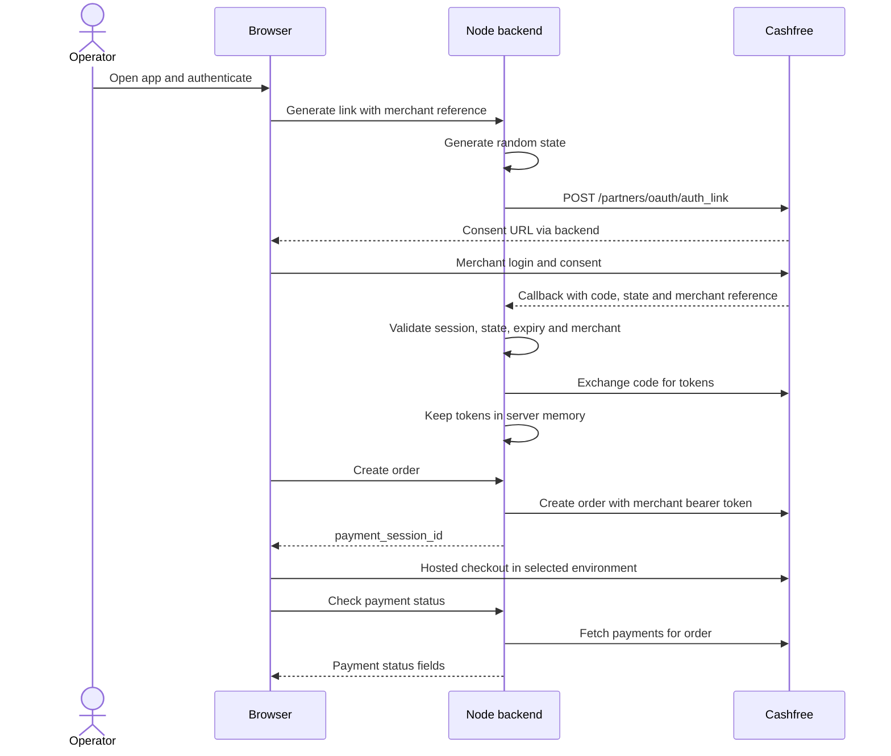

# Cashfree Partner OAuth Flow

A dependency-free Node.js sample for linking a merchant's Cashfree account through consent, creating a payment order on their behalf, opening hosted checkout, checking payments, refreshing tokens, and revoking access.

This reference app supports **sandbox and production**. Partners choose their environment, matching credentials, endpoint settings, API version and payment return URL in server-side configuration. Sandbox is the default for initial integration; production mode is available when you have production credentials.

The original integration was manually tested in sandbox by the sample author. Production credentials were unavailable, so production behavior is covered by mocked tests and has not been verified against live Cashfree services. The app is an integration reference with a single operator login and in-memory tokens; adapt those components for your deployment.

## Prerequisites

- Node.js 22 or newer. There are no npm packages to install.
- An Embedded Partner account enabled by Cashfree, with access to the Partner Dashboard's selected environment and an OAuth application.
- Your environment-specific Partner API Key, OAuth Client ID, and OAuth Client Secret. Merchant PG App ID/Secret Key credentials are a different authentication method.
- A browser with cookies enabled. Use the same browser and origin throughout consent and callback.

## Local setup

```sh
cd partner_oauth_flow
cp .env.example .env
chmod 600 .env
node -e "console.log(require('node:crypto').randomBytes(32).toString('hex'))"
```

Copy the generated random password into `APP_PASSWORD` in your local `.env`. Fill the three blank `CASHFREE_*` credential fields with values for your selected environment. Never commit or share this file. Environment variables supplied by the process take precedence over `.env`.

| Variable | Purpose |
| --- | --- |
| `CASHFREE_ENV` | `sandbox` (default) or `production`. |
| `CASHFREE_API_BASE_URL` | Partner API origin. Blank uses the selected environment's default below. |
| `CASHFREE_PG_BASE_URL` | Payment API origin. Blank uses the selected environment's default below. |
| `CASHFREE_PG_API_VERSION` | Payment API version; defaults to `2023-08-01`. Choose a supported version for your integration. |
| `CASHFREE_PARTNER_API_KEY` | Private partner credential, sent only by the backend. |
| `CASHFREE_OAUTH_CLIENT_ID` | OAuth application identifier. |
| `CASHFREE_OAUTH_CLIENT_SECRET` | Private OAuth application credential, sent only on backend OAuth calls. |
| `APP_PASSWORD` | Random operator password, at least 24 characters, without colons. |
| `PORT` | Local listening port; defaults to `3000`. |
| `APP_BASE_URL` | Browser-facing origin, such as `http://localhost:3000`; production requires HTTPS. No path or credentials. |
| `CASHFREE_RETURN_URL` | Full payment return URL; defaults to `APP_BASE_URL/?order_id={order_id}`. Production requires a valid HTTPS URL. |

### Choose an environment

| `CASHFREE_ENV` | Partner API base | Payment API base | Checkout SDK mode |
| --- | --- | --- | --- |
| `sandbox` | `https://api-sandbox.cashfree.com` | `https://sandbox.cashfree.com` | `sandbox` |
| `production` | `https://api.cashfree.com` | `https://cashfree.com` | `production` |

Leave endpoint variables blank for automatic selection, or set them explicitly to the matching official origins. The app rejects endpoint/environment mismatches and arbitrary destinations to prevent sending private credentials to the wrong service. The backend and browser checkout always use the same selected environment. This follows Cashfree's [environment configuration guidance](https://www.cashfree.com/docs/partners/embedded/oauth-flow#production-deployment).

Use sandbox credentials and synthetic customer data for testing. To use production, set these local configuration values, supply your own **production** keys in the blank credential fields, and restart:

```env
CASHFREE_ENV=production
CASHFREE_API_BASE_URL=https://api.cashfree.com
CASHFREE_PG_BASE_URL=https://cashfree.com
APP_BASE_URL=https://partner.example.com
CASHFREE_RETURN_URL=https://merchant.example.com/payments/return?order_id={order_id}
CASHFREE_OAUTH_CLIENT_ID=
CASHFREE_OAUTH_CLIENT_SECRET=
CASHFREE_PARTNER_API_KEY=
```

Keep the generated `APP_PASSWORD` and the other settings in your local `.env`. Do not mix sandbox and production credentials. Production mode sends requests to live Cashfree services and can create real payment orders.

### OAuth callback and payment return URL

These URLs serve different purposes:

- **OAuth callback:** `APP_BASE_URL/oauth/callback` receives the merchant authorization code. Register this exact URL in the OAuth application for the selected environment. This sample implements the callback at that fixed path.
- **Payment return URL:** `CASHFREE_RETURN_URL` receives the customer after hosted checkout. Partners can configure a valid HTTPS URL in production, including a URL on a different merchant-owned domain. `{order_id}` is an optional order-reference placeholder. The destination must be a page you control; a successful redirect alone does not confirm payment.

Both the application origin and payment return URL must use HTTPS in production. Sandbox additionally permits `http://localhost:PORT` for local integration. URL credentials, fragments and whitespace are rejected. See the [Create Order API](https://www.cashfree.com/docs/api-reference/payments/latest/orders/create-order) for payment return metadata.

For the local sandbox example, in **Partner Dashboard → Developers → OAuth App**, register the exact redirect URL:

```text
http://localhost:3000/oauth/callback
```

For production, register `https://partner.example.com/oauth/callback` instead and open the configured HTTPS application URL.

Then run:

```sh
npm start
```

Open `http://localhost:3000`. Sign in at the browser's HTTP authentication prompt with username **`operator`** and the `APP_PASSWORD` you generated. Opening the home page creates an HttpOnly, SameSite=Lax browser session; it lasts eight hours. All browser API requests require this session and operator authentication.

### Testing through an HTTPS tunnel

If Cashfree requires a public callback or you want to receive webhooks, forward an HTTPS tunnel to `127.0.0.1:3000`. Set `APP_BASE_URL=https://your-tunnel.example`, register `https://your-tunnel.example/oauth/callback`, restart the app, and open the **HTTPS tunnel URL** in your browser before linking. The origin must stay the same throughout the flow; do not switch between localhost and the tunnel.

The server always binds to loopback. Configure the tunnel to preserve the public `Host` header. A proxy that rewrites Host to localhost will receive `403 Unexpected request host`. Disable tunnel/proxy request recording and redact callback query strings and Authorization headers from access logs. The app does not trust forwarded headers. Public origins must use HTTPS; only local `http://localhost:PORT` is allowed over HTTP. HTTPS sessions also receive the Secure cookie flag.

## End-to-end flow



1. **Link Merchant:** enter a unique internal reference of 1–40 letters, digits, underscores or hyphens, or click **Generate ID**. The backend generates a 32-byte random state; client-supplied state is ignored. It requests the `code` response type and `read_write` scope. Only an HTTPS consent link on `auth.cashfree.com` is accepted.
2. **Consent:** open the returned link and complete the merchant's Cashfree login and consent. The browser returns to `/oauth/callback`. The backend checks that state belongs to this browser, has not expired, and has not been used. This demo expires pending state after **10 minutes**. Callback and token merchant references must match the original reference.
3. **Token exchange:** the backend exchanges the code immediately and redirects to the app without displaying the code or tokens. Access and refresh tokens remain in process memory. Restarting loses all local links and pending consent requests, but **does not revoke Cashfree's grant**. Revoke through Cashfree's dashboard if the app has already been stopped.
4. **Create Order:** enter the linked reference and an amount between 1 and 10,000 INR. Enter the customer phone appropriate for your selected environment; use synthetic customer data in sandbox. The server creates the order with the linked merchant's bearer token. Only order ID/status and the short-lived `payment_session_id` are returned to the browser. Do not share the session ID or response panel.
5. **Open Checkout:** the Cashfree JS SDK opens hosted checkout in the selected environment. Allowlist your test domain in Cashfree's payment configuration if required. A redirect to the return URL is **not proof of payment**.
6. **Check Payment Status:** enter the same merchant reference and order ID to fetch payment outcomes from Cashfree. Use the returned payment status to inspect the result. This demo does not fulfil orders.
7. **Refresh token:** click **Refresh token** on a merchant. The new refresh token replaces the old one when returned. The server also refreshes automatically before an order/payment request when the access token has less than five minutes remaining. Concurrent refreshes for one merchant share a single provider request.
8. **Status/Revoke:** **Status** requests linking status; **Revoke** revokes the provider grant and deletes local tokens after a successful response. Relink through consent to use the merchant again.

Cashfree's [OAuth integration guide](https://www.cashfree.com/docs/partners/embedded/oauth-flow) describes provider-side consent/code/token lifetimes and refresh rotation. This sample uses `expires_in` from the token response, falling back to 24 hours, and imposes its own shorter state lifetime.

## Routes and upstream APIs

All operator routes require HTTP Basic authentication. `/api/*` and `/oauth/callback` also require the browser session. POST API requests must have the exact `APP_BASE_URL` Origin and `Content-Type: application/json`; an empty POST can send `{}`. There is no public manual code-exchange endpoint.

| App route | Behavior / Cashfree request |
| --- | --- |
| `GET /api/config` | Non-secret configuration and credential-presence flags. |
| `POST /api/oauth/auth-link` | Body: `{"merchant_id":"demo_business"}`. Calls `POST {CASHFREE_API_BASE_URL}/partners/oauth/auth_link`. |
| `GET /oauth/callback` | Validates callback, calls `POST /partners/oauth/token` with `grant_type=authorization_code`. |
| `GET /api/merchants` | Lists local link metadata, without tokens. |
| `GET /api/merchants/:id/status` | Calls `GET /partners/merchants/:id`, API version `2023-01-01`. |
| `POST /api/merchants/:id/refresh` | Calls `POST /partners/oauth/token` with `grant_type=refresh_token`. |
| `POST /api/merchants/:id/revoke` | Calls `POST /partners/oauth/:id/revoke`. |
| `POST /api/orders` | Body: `{"merchant_id":"demo_business","order_amount":10}`. Calls `POST {CASHFREE_PG_BASE_URL}/pg/orders`. |
| `GET /api/orders/:orderId/payments?merchant_id=:id` | Calls `GET /pg/orders/:orderId/payments`. |
| `POST /webhooks/cashfree` | Signature-authenticated acknowledgement; does not require operator login. |

Partner calls use `x-partner-apikey` and `oauth-client-id`; OAuth calls also send `oauth-client-secret`. Payment calls use `Authorization: Bearer <merchant access token>` and the configured `CASHFREE_PG_API_VERSION`. Credentials are never included in frontend code or request URLs. Confirm enabled OAuth capabilities and supported API versions with Cashfree for your partner account.

## Optional webhooks

In the selected environment's Partner Dashboard webhook settings, register:

```text
https://your-tunnel.example/webhooks/cashfree
```

The receiver checks `x-webhook-timestamp` (Unix milliseconds, within five minutes) and `x-webhook-signature` using Base64 HMAC-SHA256 of `timestamp + raw request body`, with the Partner API Key. Comparison is constant-time. The body is capped at 16 KiB. Valid JSON events receive `200 {"ok":true}`; the app never logs payloads or changes business state from them. Duplicate deliveries therefore have no side effects. Older retry deliveries outside the five-minute window are rejected; inspect payment status through the API in this demo.

For a production receiver, persist verified events, deduplicate event IDs, handle unlink events, and process fulfilment asynchronously. See Cashfree's [partner webhook signature guidance](https://www.cashfree.com/docs/partners/embedded/integration/gateway-integration#webhook-signature).

## Security and publication

- `.env`, saved tokens, merchant records, OAuth state files, local tunnel addresses, generated guides/screenshots and private key files from the original local sample are not included.
- `.gitignore` excludes local environment files, runtime data, private key files, logs and installed dependencies. Only `.env.example`, with blank credential/password fields, is intended for version control.
- Tokens are kept only in backend memory. Token responses are reduced to non-secret metadata. Upstream error bodies and customer details are not forwarded to the UI; no credential previews are exposed.
- Static serving allows only the three known public assets. Runtime files and source code cannot be downloaded through the app.
- Browser responses disable caching, disallow framing, prevent MIME sniffing, suppress referrers, and set a Content Security Policy. Upstream requests have a 15-second timeout and reject redirects to avoid forwarding credentials elsewhere.
- Treat the browser response panel, callback query strings, payment sessions and the machine's memory as sensitive. Stop the tunnel and server after testing, revoke grants you no longer need, and rotate any credentials that were previously exposed. HTTP Basic credentials can remain cached until the browser session is closed.

Before production use, replace the shared operator login with your identity system, tenant-level authorization, rate limiting and audit controls; use a managed secret store and encrypted persistent token storage; implement durable webhook deduplication and fulfilment; and obtain a security review against your actual deployment and regulatory requirements. Supporting production endpoints does not establish PCI DSS or other regulatory compliance.

## Validation

```sh
npm test
node --check server.js
node --check public/app.js
```

Tests use generated fake credentials and mock all Cashfree requests. The flow suite runs with both sandbox and production configurations, including environment-specific endpoint selection and payment return URL forwarding. Configuration tests verify HTTPS enforcement and endpoint validation. They cover authentication, host/origin checks, static-file restrictions, session-bound/single-use/expired state, merchant mismatch, token redaction, refresh rotation, orders, status checks, webhook signatures and revocation. They do not contact Cashfree or prove live account compatibility. Complete consent, checkout, payment verification, refresh, webhook and revocation checks manually with your own sandbox account, then validate the production integration with your production credentials before rollout.

## Troubleshooting

| Symptom | Action |
| --- | --- |
| Startup rejects password or environment | Generate a random `APP_PASSWORD` of at least 24 characters; select `sandbox` or `production` and use matching endpoints. |
| Startup rejects production URLs | Set HTTPS `APP_BASE_URL` and `CASHFREE_RETURN_URL`; localhost HTTP is sandbox-only. |
| Unexpected request host / same-origin error | Open the exact `APP_BASE_URL`; preserve its Host through the proxy. |
| Open the app in this browser first | Load `/` to establish the session; allow cookies and keep the same origin/browser. |
| Missing/expired state or merchant mismatch | Start a new consent request; do not reuse callbacks or change the reference. |
| Generic upstream request failure | Check credentials for the selected environment, partner OAuth enablement, redirect URL and network access. Error bodies are intentionally not displayed. |
| No local merchants after restart | Tokens are memory-only; reauthorize or revoke the old grant via the dashboard. |
| Checkout does not open | Create a new order and check domain allowlisting, SDK loading and browser console policy errors. |
| Webhook rejected | Check the selected environment's partner key, untouched raw body, timestamp format and local clock accuracy. |
